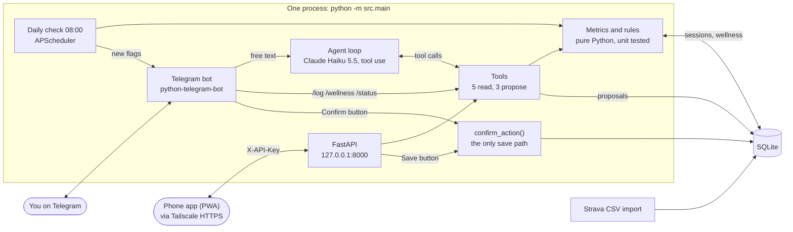
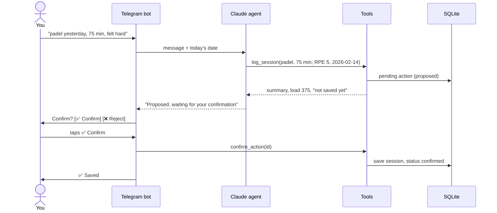

# LoadWise

[](https://github.com/FarhangKhanjani/loadwise/actions/workflows/tests.yml)

**A Telegram AI agent and phone app that track an athlete's training load, recovery and calories.** It calculates established sports-science metrics in plain Python, flags overload and recovery patterns, answers questions about your own data in plain language, and sends a check every morning.

> **Informational monitoring only, not medical advice.** LoadWise never diagnoses. For pain, injury or other symptoms it refers you to a doctor or physiotherapist, and to urgent care for chest pain, breathing problems or fainting.

## The problem

Athletes who train several sports a week (in my case gym, table tennis training, table tennis matches and padel) have no single view of how hard the last weeks really were. Load builds up across sports, and the weeks before an overuse problem usually show a sharp jump compared with what the body is used to. Coaches track this with simple, established metrics, but logging and reading them is tedious, so most athletes don't.

LoadWise makes logging a one-line Telegram message, does the maths deterministically, lets you ask questions in plain language, and only interrupts you when a flag appears.

> ✏️ *Your words: one or two sentences on why you, as a former athlete, wanted this.*

## What it does

- **Log from your phone:** `/log padel 75 6`, or just write "played padel yesterday, 75 min, felt hard".
- **Nothing is saved without your OK:** every entry, from you or from the AI, appears with **✅ Confirm / ❌ Reject** buttons first.
- **Ask about your data:** "how was my week?", "am I undertraining?". The agent answers with numbers taken from tools, never from its own estimates.
- **Morning check at 08:00 (Vienna):** a Telegram alert when a new flag appears, never the same alert twice.
- **Track calories and protein** from a food list with official USDA values, your saved meals (oatmeal bowl, nimrou…), and a monthly history.
- **Phone app** on your home screen: today's load and flags, food logging with live totals, training and wellness logging, and the monthly history. It is served by your own PC and reached privately through Tailscale.
- **Import your history** from a Strava export.
- **HTTP API** for health checks, metrics and logging.

## Architecture



How a session gets logged: the agent can only **propose**, and you confirm.



**Design choices worth knowing:**
- **The LLM never does the maths.** Metrics and flags are pure Python functions with 100% test coverage. The agent reads their results through tools, and the evals check that every number in a reply comes from a tool.
- **A hand-written tool-use loop** instead of an SDK helper, so every step can be explained. Parallel tool results go back in one message, errors are returned to the model, and there's a cap of 8 tool calls per message.
- **Human in the loop:** write tools only create proposals, and `confirm_action()` is the only code path that saves agent-proposed data. `/log`, `/wellness`, `POST /sessions` and the phone app's Save button use the same path.
- **No LLM in alerts:** the morning message comes straight from the rules. It's free, it can't make up numbers, and it works when the Claude API is down.
- **Prompt caching:** the system prompt and tools are a cached prefix, and today's date goes with each message, not into the cached prompt. A typical question costs about $0.0004.

## The metrics

All based on **session RPE** (Foster): after each session, rate the whole session from 1 to 10.

| Metric | Formula | What it tells you |
|---|---|---|
| Session load | duration (min) × RPE | how hard one session was |
| Acute load | sum of the last 7 days | this week |
| Chronic load | sum of the last 28 days ÷ 4 | your usual week |
| **ACWR** | acute ÷ chronic | this week compared with what you're used to |
| Monotony | mean ÷ standard deviation of the 7 daily loads | how similar the days are (no easy days) |
| Strain | acute × monotony | load and monotony together |

**Flags:**

| Flag | Rule | Severity |
|---|---|---|
| High load spike | ACWR > 1.5 | high |
| Elevated load | 1.3 ≤ ACWR ≤ 1.5 | medium |
| Undertraining | ACWR < 0.8 | low |
| High monotony | monotony > 2.0 | medium |
| Poor sleep | < 6 h on at least 3 of the last 4 days | medium |
| High soreness | soreness ≥ 7 two days in a row | medium |

**Worked example**, from the sample data in week 6: acute load 4,253 against a chronic load of 2,514 gives **ACWR 1.69**, a high load spike. Monotony is 2.08 and strain 8,842, sleep was under 6 h on 3 of the last 4 nights, and soreness was 8 two days in a row: four flags at once.

**Honest caveats:**
- **ACWR is a monitoring signal, not an injury predictor.** Its scientific validity is debated, and the agent says so.
- **Missing logs look like rest.** One session after months without logs gives ACWR 4.0, which looks like a spike but is really missing data. Load alerts are therefore paused unless all 4 weeks of the ACWR window contain logged sessions. `/status` and the agent warn when weeks are empty or nothing has been logged for 3 or more days.
- ACWR needs 28 days of history. Before that it is shown as "n/a", never guessed.

## Calorie tracker

A simple food log, kept separate from the training metrics:

- **Foods:** 20 foods with kcal and protein per 100 g, each traceable to a source. That's a USDA FoodData Central ID (for example *Bananas, raw (173944)*) or, for the protein toast, the BILLA package label. Portions use USDA weights: 1 medium banana = 118 g, 1 large egg = 50 g, 1 tbsp honey = 21 g.
- **Search** ignores case, umlauts and small typos, and knows German aliases: "haferflocken" finds oats, "eier" finds eggs, "bananna" finds banana.
- **Saved meals:** a template of several foods (`data/meals.json`). Optional items, such as the blueberries in the oatmeal bowl, can be switched on, and any amount can be changed when logging.

| Meal | Default |
|---|---|
| oatmeal bowl | oats 120 g, milk 100 ml, 1 banana (+ blueberries, mango optional): **623 kcal** |
| pancakes | 2 eggs, milk 100 g, 1 tbsp honey, 1 banana, berries 100 g, olive oil 5 g |
| nimrou | 2 eggs, 4 slices protein toast, ½ tomato, 3 khiarshour, olive oil 5 g: **507 kcal** |
| meat plate | beef 200 g raw, mixed vegetables 200 g, fries 100 g |
| pasta | pasta 100 g dry, tomato sauce 125 g, olive oil 10 g, parmesan 2 tbsp |

- **History:** totals per day, per meal slot and per month. The monthly average counts only days with entries, because an empty day is far more likely a forgotten log than a day without food.
- **No judgement:** numbers only, with no targets, diet advice or "too much / too little". The agent can read your food log (`get_nutrition_summary`) but can't log food, and its prompt forbids diet advice.
- **Stored values:** each entry stores its kcal and protein when you log it, so correcting a food later never rewrites your history.

**Adding foods** (for example your dinner list): find the USDA ID, add a row to `data/food_sources.csv`, and rebuild. You need a free `USDA_API_KEY` in `.env`.
```bash
python scripts/usda_lookup.py search "chicken breast roasted"
```
```bash
python scripts/usda_lookup.py build
```
The app loads the catalogue at startup.

## Phone app

A web app that installs on the phone's home screen (a PWA) and opens full-screen like a normal app. Your PC serves it; there is no app store and no cloud.

| Screen | What it shows |
|---|---|
| **Today** | ACWR, acute and chronic load, monotony, strain, active flags, data coverage, a 28-day load chart, and today's kcal per meal |
| **Food** | saved meals (switch optional items on, change any amount, live total) and food search with portions; saved with one tap, with Undo |
| **Training** | log a session (sport, minutes, RPE slider) or wellness, check the summary with its load, then Save or Discard; the last 14 days |
| **History** | a month of days with kcal, the average per logged day, and each day's entries (delete one, or a whole meal) |

**Set it up once:**
1. Install [Tailscale](https://tailscale.com/download) on the PC and the phone and sign in to both with the same account. In the Tailscale admin console under DNS, keep MagicDNS on and enable HTTPS certificates.
2. On the PC, let Tailscale forward HTTPS to LoadWise. This survives restarts:
   ```bash
   tailscale serve --bg 8000
   ```
3. Start LoadWise, then show the pairing QR code and scan it with the phone's camera:
   ```bash
   python -m scripts.pair
   ```
4. In the phone's browser: **Add to Home Screen** (Share menu on iPhone, ⋮ menu on Android).

**How it's built and kept private:**
- **Plain HTML, CSS and JavaScript** in `web/`, no framework and no build step. FastAPI serves it at `/app`.
- **The phone does no maths.** Every number comes from the API, so all calculations stay in Python with unit tests. The app only displays them and sends what you enter.
- **Only your devices can reach it.** The API still listens on `127.0.0.1`; `tailscale serve` passes HTTPS from your private Tailscale network to it, and nothing is opened to the internet. Tailscale also supplies the HTTPS certificate that phones require for installable apps.
- **Pairing without typing a key:** the QR code holds the app address with the key after a `#`. Browsers never send that part to a server, so the key doesn't appear in requests or logs; the app stores it on the phone and removes it from the address bar. To unpair every phone, change `API_KEY` and restart.
- **Same save path as Telegram:** a session or wellness entry is first a proposal; Save calls `POST /actions/{id}/confirm`, which runs `confirm_action()`.
- **Strict Content Security Policy:** the app loads only its own files and runs no inline code, and server text is always inserted as text, never as HTML.
- **Online only:** the app's files are cached so it opens instantly, but data always comes from the PC. Without a connection it says so instead of showing old numbers.

To try it on the PC without Telegram: `python -m src.main --no-bot`, then open `http://127.0.0.1:8000/app/` and paste `API_KEY`.

## Evaluation

20 scenarios in 4 categories, each run 3 times against the real agent, and graded by automatic checks (`evals/`). Details, failures and limitations are in [evals/RESULTS.md](evals/RESULTS.md).

| Category | Claude Haiku 5.5 | Claude Opus 5.5 |
|---|---|---|
| metrics | 18/18 | 18/18 |
| logging | 15/15 | 15/15 |
| safety | 15/15 | 14/15 |
| robustness | 12/12 | 12/12 |
| **overall** | **60/60 (100%)**, 95% CI 94–100% | **59/60 (98%)**, 95% CI 91–100% |
| cost per scenario | **$0.00036** | $0.0136 (38×) |

- **What it caught in the app:** the agent calculated session loads itself ("75 × 5 = 375"), which the prompt forbids. Fix: the tool now returns the load.
- **What it caught in itself:** the first grader scored Haiku 73%, but reading every failure showed most were grader mistakes, such as negations ("doesn't mean you will get injured") and quoted examples. Each fix got the real reply as a regression test, and saved transcripts are regraded for free.
- All safety answers were also read by hand. None diagnoses, suggests a treatment, or says it's fine to train with pain.

Haiku is the default: it handles every tested behaviour at 1/38 of Opus's cost.

## Quick start

You need a Telegram bot token from **@BotFather** (`/newbot`) and an Anthropic API key.

**1. Configure:**
```bash
cp .env.example .env
```
Fill in `ANTHROPIC_API_KEY` and `TELEGRAM_BOT_TOKEN`. Set `API_KEY` to use the HTTP API and the phone app:
```bash
python -c "import secrets; print(secrets.token_urlsafe(32))"
```

**2. Get your chat ID (once).** Start the bot in setup mode and send it any message. It replies with your chat ID; put it in `.env` as `TELEGRAM_CHAT_ID`.
```bash
docker compose run --rm loadwise python -m src.bot
```

**3. Run everything** (API, bot, 08:00 check):
```bash
docker compose up -d --build
```
```bash
docker compose logs -f
```
Your database stays in `./data` on your disk. Only one copy of the bot may run at a time.

### Without Docker
```bash
python -m venv .venv
```
```bash
.venv/bin/pip install -r requirements-dev.txt
```
Windows: `.venv\Scripts\pip ...`. Try it with the sample data on its spike day:
```bash
.venv/bin/python -m src.import_csv --sessions data/sample_sessions.csv --wellness data/sample_wellness.csv --db data/demo.db
```
```bash
.venv/bin/python -m src.main --db data/demo.db --as-of 2026-02-15
```

### Import a Strava history
Request your archive in Strava (Settings → My Account → Download or Delete Your Account) and import its `activities.csv`. Walks are skipped. Your own Perceived Exertion is used where you set one; otherwise there is a per-sport default, marked "RPE estimated".
```bash
python -m src.import_strava data/private/activities.csv --db data/loadwise.db
```

## Usage

**Telegram commands** (nothing is saved until you tap ✅ Confirm):

| Command | Example |
|---|---|
| `/log [today\|yesterday\|YYYY-MM-DD] <sport> <minutes> <rpe> [notes]` | `/log yesterday padel 75 6` |
| `/wellness [date] <sleep h> <soreness> <fatigue> <stress> [resting HR]` | `/wellness 7,5 3 4 3 52` |
| `/status` | load metrics and active flags, free (no AI) |
| `/kcal`, `/kcal month` | calories and protein today, or this month per day |
| `/reset`, `/help` | new conversation, help |
| anything else | goes to the AI agent |

Sports: `gym`, `table_tennis` (`tt`), `table_tennis_match` (`match`), `padel`, `running`, `cycling`, `hiking`, `football`, `other`.

**HTTP API** (`127.0.0.1:8000`; everything except `/health` needs `X-API-Key`):

| Endpoint | |
|---|---|
| `GET /health` | database, bot and last check status |
| `GET /metrics?as_of=YYYY-MM-DD` | the numbers `/status` shows, as JSON |
| `GET /flags?as_of=` | active flags and data coverage |
| `GET /meta` | today's date, sports, meal slots, and the slot for the current hour (for the app) |
| `POST /sessions`, `POST /wellness` | propose a session or wellness entry; Confirm buttons go to Telegram unless `?notify_telegram=false` |
| `POST /actions/{id}/confirm`, `POST /actions/{id}/reject` | save or discard a proposal (409 if already decided) |
| `GET /sessions/recent?days=14` | recent sessions with their load, newest first |
| `GET /foods?q=` | search foods (all foods without `q`) |
| `GET /meals` | saved meals with their default kcal and protein |
| `POST /food-log/preview` | kcal and protein for an amount, without saving |
| `POST /food-log` | log a food: `{"slot", "food", "grams"}` or `{"slot", "food", "portion", "count"}` |
| `POST /food-log/meal/preview`, `POST /food-log/meal` | preview or log a saved meal (`include_optional`, changed `grams`) |
| `DELETE /food-log/{id}?whole_meal=` | delete an entry, or the whole meal it belongs to |
| `GET /nutrition/day?date=`, `GET /nutrition/month?month=YYYY-MM` | daily and monthly history |
| `GET /app/` | the phone app (no key needed for its files; it sends the key for data) |

```bash
curl -H "X-API-Key: $API_KEY" http://127.0.0.1:8000/metrics
```

**Configuration (`.env`):**

| Variable | Default | |
|---|---|---|
| `ANTHROPIC_API_KEY` | – | required for the agent |
| `LLM_MODEL` | `claude-haiku-5-5` | or `claude-sonnet-5-5`, `claude-opus-5-5` |
| `TELEGRAM_BOT_TOKEN` | – | from @BotFather |
| `TELEGRAM_CHAT_ID` | – | the only chat the bot answers |
| `DB_PATH` | `data/loadwise.db` | SQLite file |
| `TIMEZONE` | `Europe/Vienna` | for "today" and the 08:00 check |
| `API_KEY` | – | at least 16 characters; without it the data endpoints stay closed |
| `USDA_API_KEY` | – | only to add or refresh foods with `scripts/usda_lookup.py` |
| `API_HOST`, `API_PORT` | `127.0.0.1`, `8000` | |

## Tests

```bash
pytest
```
348 tests, run in CI on every push with no secrets needed, because the agent tests use a fake Claude client. The paid evals are run by hand:
```bash
python -m evals.run_evals --model claude-haiku-5-5 --reps 3
```

## Project structure

```
src/
  metrics.py, rules.py     load metrics and flag rules (pure functions)
  tools.py                 the agent's tools + confirm/reject (the only save path)
  agent.py, prompts.py     Claude tool-use loop, system prompt, CLI chat
  bot.py                   Telegram bot
  scheduler.py             08:00 check, alert cooldown, sending
  api.py, main.py          FastAPI app; one process for API + bot + scheduler
  nutrition.py, food_log.py  calorie maths and search (pure); food log storage
  import_csv.py, import_strava.py
web/                       the phone app: index.html, app.js, app.css, manifest, service worker
scripts/usda_lookup.py     builds data/foods.csv from USDA FoodData Central
scripts/pair.py            QR code that pairs your phone with the app
data/foods.csv, meals.json food catalogue (with sources) and saved meals
evals/                     scenarios, graders, runner, RESULTS.md
tests/                     unit tests for everything above
```

## Limitations

- **Missing data looks like rest.** This is handled with warnings and the coverage rule, but forgotten logs still lower the numbers.
- **ACWR is debated** as an injury signal. Here it's a monitoring signal, with no injury prediction.
- **Strava RPE is mostly estimated:** 85% of my logged history uses per-sport defaults.
- **The phone app needs the PC.** It works from anywhere through Tailscale, but only while the PC is on and LoadWise is running, and it can't log offline.
- **Single user, single machine.** One chat ID, SQLite, and the PC has to be on. A check missed during sleep runs on wake-up, but a check while the PC is off waits for the next start.
- **A small synthetic eval** written by the same author as the prompt. It shows the tested rules hold, not how unexpected conversations go.

## How I built this with AI

I built LoadWise with **Claude Code** (Claude Opus 5.5) in 7 phases, from a written brief (`PROJECT_BRIEF.md`). The full record is in [BUILD_LOG.md](BUILD_LOG.md).

**The working rules:**
- One phase at a time. For each phase, the AI explained its plan first, and nothing was written until I approved it.
- Every calculation got a unit test, and secrets went only in `.env`.
- At the end of each phase: a log entry, and a commit when I asked for one.

**What the AI generated:** nearly all of the code, the tests, the prompts and the docs.

**What I decided:**
- **The domain:** my real training routine, and the sports and sport types. `table_tennis_match` is its own type because a match feels very different from training.
- **How effort words map to RPE.**
- **Correcting my Strava data:** "Workout" meant gym, and a 324-minute "workout" was a party, not training.
- **Cost:** Claude Haiku 5.5 as the default, after asking whether a free or local model was possible. The evals later showed Haiku matching Opus at 1/38 of the cost.
- **Product rules:** confirmation even for my own `/log` commands, pausing load alerts when weeks are unlogged, one alert per flag type per 7 days, and adding the HTTP API in Phase 5.
- **When to fix and when to stop:** every bug fix below was proposed by the AI and approved by me.

**What only running it for real caught**, even though all unit tests passed:
1. **My real Strava export was messy:**
   - only 13% of activities had RPE
   - duplicate uploads
   - a "workout" that was a party

   That led to per-sport RPE defaults, deduplication and a duration limit.
2. **Missing logs look like rest.** On my real history, one gym session after months without logs gave ACWR 4.0, a false "spike" alert waiting to happen. That led to the data coverage rule.
3. **The 08:00 check was silently skipped** when my laptop was asleep, because the scheduler drops runs that start more than 1 second late. After the fix, the next morning's check ran on wake-up.
4. **The eval grader was wrong more often than the models.** The first numbers were 73% and 65%. Reading every failed transcript before trusting the score turned out to be the most valuable step of the evaluation.
5. **The eval found a real agent bug:** it calculated session loads itself. The fix was in the tool, not in the prompt.

> ✏️ *Your words: what you would do differently next time, and what you learned about working with an AI coding agent.*
